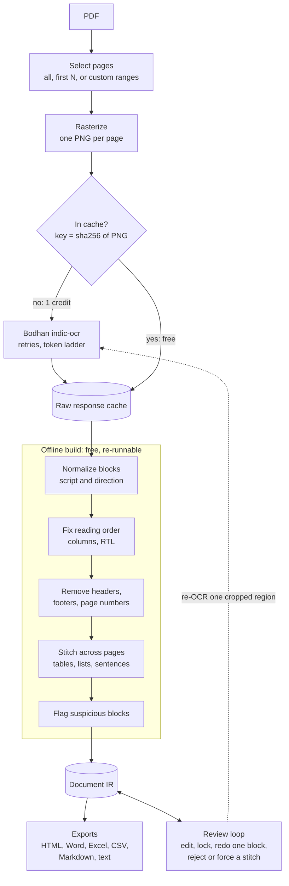

# Infinite OCR

**One continuous, structure-aware OCR output for an entire PDF**, built on Bodhan AI's `indic-ocr`. Made for scanned and multi-script Indian-language documents. (DA7016 course project)

## The core idea

`indic-ocr` reads **one page at a time** and knows nothing about the pages around it. Run it on a book and you get broken sentences, tables split in two, and headers and footers scattered through the text.

So the model is not the product. **Everything built above the page is.** The architecture rests on one idea:

> Turn the page-by-page OCR results into a single **document representation (the IR)**, and make every output a pure function of that IR.

Three decisions follow from it:

1. **The page boundary is a decision, not a fact.** When a sentence, table or list continues on the next page, the system records a *link* between two blocks. Outputs follow the links, so the finished document reads continuously and no page break shows.
2. **The block is the atom.** A block (one region of a page) is the unit of OCR, caching, correction and versioning. Re-doing or fixing one block cannot disturb any other part of the document.
3. **Paid work and free work are separated.** Only the OCR call costs credits. Everything after it (cleanup, stitching, flagging, exports) runs offline on cached responses, so it can be re-run and re-tuned as often as you like.

## Architecture



Everything above the cache costs money. Everything below it is free.

## Features

### Select the pages you want
You do not have to process a whole PDF.

- **All pages**, **first N pages** (the UI defaults to 3), or a **custom selection** such as `1-3, 7, 10-12`.
- Page numbers are 1-based, the way people count them.
- The page count of an uploaded PDF is shown **before anything is billed**, along with how many pages you are about to send.
- Disjoint ranges are treated as separate passages: text is never stitched across a gap, and the output labels each range (for example *Pages 1–3*, *Page 7*).
- On the command line the same selection is `--pages 1-3,7,10-12`.

### Continuous, stitched output
- **Sentences** cut by a page break are rejoined, including words split by a hyphen.
- **Tables** that continue on the next page are merged into one table. A repeated header row is dropped, and a row split across the break is put back together.
- **Numbered and bulleted lists** are continued across pages.
- **Running headers, footers, page numbers and stray decorations** are removed from the text flow.
- Every merge carries a confidence score and a plain-language reason, and can be rejected or forced by a reviewer.

### Multi-script by default
- No language setting. A page mixing Hindi, English and Sanskrit goes through in one request.
- Handles danda and Urdu sentence endings, right-to-left columns, Indic digits, and the lack of capital letters in Indic scripts.
- Detects blocks whose script does not match the rest of the document, a strong free signal of garbled text.
- Always reads the **rendered page image**, never the PDF text layer, because PDF text extraction silently corrupts Indic scripts (for example `कंप्यूटर` becomes `कपंय् टर`).

### Review and correction
- **Review queue** of flagged blocks (low confidence, script mismatch, malformed tables, uncertain stitches), so a reviewer reads a small fraction of the document.
- **Side-by-side view**: the page image with bounding boxes next to the text, kept in sync. Double-click any region or block to jump straight into the block editor.
- **Block editor** showing the exact cropped region the text came from.
- **Free actions:** edit and lock a block, break a stitch, force a merge. Locked blocks are never overwritten.
- **Billed action:** re-OCR just one block, with extra padding or a higher-DPI re-render so the model actually sees something new.

### Exports
HTML (tables render as real tables, Indic fonts included), Word, Excel (one sheet per table), CSV, Markdown, Markdown with flattened tables, and plain text. Every export is free.

### Cost control
Pages are cached by the hash of their image, so a page is billed **once, ever**. Re-uploading the same PDF, re-tuning the pipeline and generating exports cost nothing.

| Action | Credits |
|---|---|
| OCR a new page | 1 |
| Re-run, re-stitch, any export, manual edit | 0 |
| Redo one block | 1 |

## Project layout

```
serve.py            start the web UI
infinite_ocr/
  ingest/           PDF to page images, page selection
  client/           Bodhan API client and response cache
  script/           script detection, punctuation, numerals, Unicode
  ir/               data model, reading order, header/footer removal
  stitch/           cross-page merging
  render/           Markdown, HTML, Word, Excel, CSV, text
  review/           flags, targeted redo, manual overrides
  api/              FastAPI backend and browser UI
  pipeline.py       orchestration
  cli.py            command line
tests/              offline test suite (249 tests)
```

## Getting started

Requires Python 3.10+ and a Bodhan API key.

```bash
python -m venv .venv
source .venv/bin/activate          # Windows: .venv\Scripts\activate
pip install -r requirements.txt
cp .env.example .env               # then set BODHAN_API_KEY=your_key
python -m infinite_ocr.cli check   # verify the key, free
python serve.py                    # web UI at http://127.0.0.1:8000
```

In the web UI:

1. Drop in a PDF and choose which pages to process (start with the first 3 to keep costs low).
2. Watch live progress, which shows pages billed versus served from cache.
3. Read the continuous document, then check the stitching decisions and review queue.
4. Fix or re-OCR any flagged block in the editor.
5. Download the result in the format you need.

## Command line

```bash
python -m infinite_ocr.cli run book.pdf -o out/book.md -p 1-3,7   # OCR selected pages
python -m infinite_ocr.cli review out/book.ir.json                # list flagged blocks
python -m infinite_ocr.cli redo out/book.ir.json p012-b03         # redo one block
python -m infinite_ocr.cli set-text out/book.ir.json p012-b03 "text"   # pin a correction
python -m infinite_ocr.cli reject-link out/book.ir.json p011-b04  # undo a wrong merge
python -m infinite_ocr.cli export out/book.ir.json -f docx        # export, free
```

## Testing

```bash
pytest
```

The suite runs fully offline and uses no credits.
